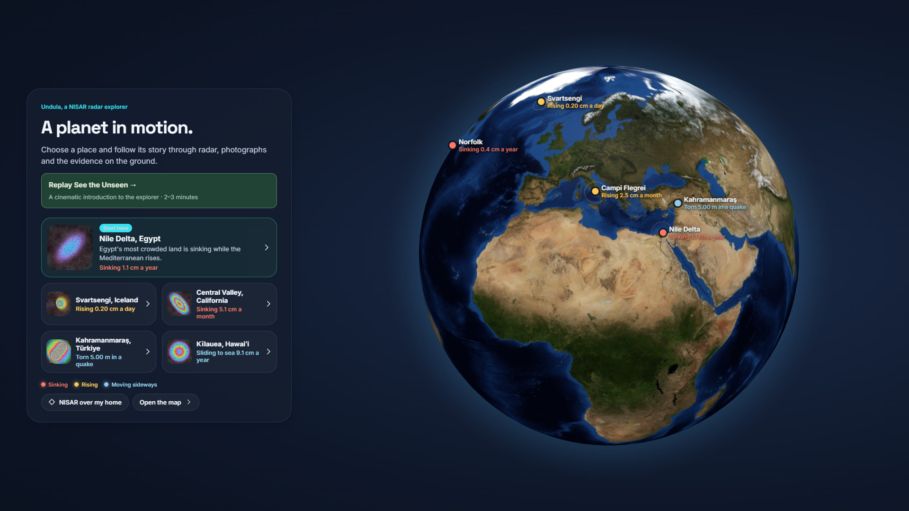
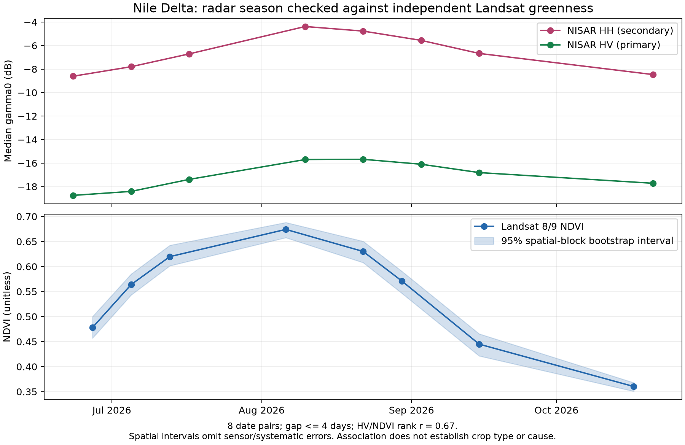

# Undula

**Hear the ground move.**

**[Explore Undula live →](https://undula.vercel.app/)**

Undula is an open-source browser application for exploring Earth's changing surface with **NASA–ISRO NISAR radar**. Start with a place, play its observations through time, explore a physical model, and follow an explanation back to its sources. Our starting point is Egypt's Nile Delta; the explorer connects it with subsiding cities, volcanoes and faults around the world.

Built by **Team Shiblanga** for **NASA Space Apps — Dancing with the SARs**. Maintained by **[Mohamed Tamer](https://github.com/MohamedO6)**.



*Globe labels provide cited historical context and model examples. The application distinguishes those from the NISAR observation layers and derived measurements.*

[Run locally](#run-locally) · [Explore the science](#data-and-science) · [Reproduce the analysis](pipeline/SCIENCE.md) · [Deploy on Vercel](docs/DEPLOYMENT.md) · [Sources and credits](docs/ACKNOWLEDGMENTS.md)

## A place, a signal, an explanation

Radar observations can reveal surface changes that are difficult to notice on the ground. Understanding them requires more than displaying a colourful image: the user needs a location, a timeline, a physical explanation and a way to inspect the evidence.

Undula brings those pieces together in one interface. It is designed for students, educators and curious residents who want to explore a changing landscape without installing specialist radar software.

| Explore | What the application offers |
| --- | --- |
| **Real radar observations** | Play dated NISAR interferogram and backscatter previews, inspect available full-product results and follow source links. |
| **Any location** | Select a point and query NASA's catalogue for available NISAR GCOV previews, with acquisition dates and links to ASF. Availability depends on coverage. |
| **Seasonal change** | Inspect measured HH/HV backscatter over the Delta and its comparison with independent Landsat greenness. |
| **Motion models** | Explore subsidence, volcanic sources and faults. Change parameters in the Interference Lab and inspect the resulting fringes. |
| **Sound** | In model mode, each whole centimetre of modelled relative line-of-sight motion triggers a note. Descending notes represent subsidence; radar mode uses pings to mark acquisition-pair progression. |
| **Astrounit** | Move an astronaut guide across the map, discover regional context and request radar imagery at a location. |
| **Then & Now** | Compare optical satellite images with their capture dates and imagery-source information. |
| **Sea 2100** | Explore a simplified fixed-rate elevation scenario for the Nile Delta or Norfolk, with and without continued subsidence. |
| **Evidence** | Inspect sources, available GNSS context and comparisons, processing details and time-stamped evidence records. |

## Data and science

The bundle separates previews, full-product processing and an independent optical comparison.

| Included material | Scope |
| --- | --- |
| **93 unique GUNW pairs** | Eleven tracks across nine of the explorer's ten locations. The tenth location has contextual material without a bundled radar sequence. |
| **17 full-product GUNW pairs** | Nine in Central Valley and eight in the Nile Delta, processed to relative line-of-sight estimates with validity masks. |
| **9 GCOV browse frames** | A dated HH/HV composite sequence over the Nile Delta. |
| **10 full GCOV dates** | A separate June–October 2026 backscatter study over a 20 × 20 km area near Kafr El Sheikh. |
| **8 matched Landsat observations** | A quality-filtered, independent optical greenness comparison over the same study area. |
| **Additional context** | GNSS series, Copernicus elevation, dated optical imagery, credited photographs and cited publications. |

### A scientific question we tested

**Is seasonal change in radar backscatter consistent with vegetation greenness measured by another satellite?**

We measured NISAR HH/HV gamma0 backscatter across ten dates and compared it with Landsat 8/9 surface-reflectance NDVI. Fixed date and quality rules accepted eight matches within four calendar days. Every accepted optical date uses the same valid support, covering 98.3% of the study footprint.

The primary HV/NDVI Spearman correlation is **0.67**; the secondary HH result is **0.76**. A first-difference rate comparison is **0.86** across seven intervals. Leaving one date out gives primary correlations from approximately **0.54 to 0.82**.



*Supporting regional evidence from one area and one season. Correlations are descriptive associations, not accuracy percentages. The shaded interval describes spatial resampling variability and omits sensor and atmospheric uncertainty.*

Inspect the [methods and sensitivity checks](pipeline/SCIENCE.md), [paired measurements](data/nisar/nile-delta/season-check.csv), [scene IDs and exclusions](data/nisar/nile-delta/season-check.json), and [radar-processing details](pipeline/README.md).

### What each layer means

| Layer | Interpretation |
| --- | --- |
| **Observations** | Satellite and GNSS data from the credited providers. Browse images support exploration; their display is not a calibrated measurement by itself. |
| **Derived results** | Processed LOS estimates, backscatter summaries and the optical comparison, with methods and limitations. |
| **Models** | Analytic fringe patterns and their translation into sound. These explain a mechanism and remain distinct from observations. |
| **Scenarios** | Sea 2100 illustrates fixed assumptions; it is not a forecast of actual inundation. |

The full-product GUNW estimates are relative LOS, **not absolute vertical subsidence rates**. About 4.7% of the displayed Delta grid remains valid through the cumulative sequence; other pixels are unknown. No usable simultaneous Delta GNSS comparison was obtained, and the Central Valley comparison did not resolve small motion against a zero-motion baseline. The Landsat analysis tests seasonal consistency, not ground-displacement accuracy or crop/flood classification. Time-stamped fingerprints establish record integrity, not scientific correctness.

## Run locally

The application is plain HTML, CSS and JavaScript. **There is no frontend build step and no package installation is needed to view it.**

```sh
git clone https://github.com/MohamedO6/Undula.git
cd Undula
python -m http.server 5173 --bind 127.0.0.1
```

Open **http://127.0.0.1:5173/** in a modern browser with WebGL support. Enable sound through the application's sound button when you want to use it.

Bundled observations are served from this repository. External basemaps, fresh NASA queries, source links and live timestamp verification require an internet connection. The browser application does not require Earthdata credentials; full-product reprocessing has separate authentication requirements.

## Verify and reproduce

Check the bundled data, indexed assets, binary grids and recorded fingerprints without downloading new observations:

```sh
python Tools/audit_web.py --check
```

For scientific pipeline dependencies and the optical-analysis checks:

```sh
python -m pip install -r pipeline/science-requirements.txt
python -m unittest discover -s pipeline/tests -v
python pipeline/season_check.py
```

The optical workflow reads public Landsat windows. Its `--offline` option requires a previously populated local cache. Full GUNW/GCOV processing requires NASA Earthdata authentication and is documented in [pipeline/README.md](pipeline/README.md). Granule IDs and selection rules pin the bundled analysis; a new catalogue query can discover different or reprocessed observations.

## Deploy on Vercel

Import **`MohamedO6/Undula`**, select the repository root and use the **Other** framework preset. The committed configuration serves the static application from `.` with installation and build commands disabled. See [deployment instructions](docs/DEPLOYMENT.md).

This repository contains the application, its scientific bundle and processing code. Presentation decks, pitch films and film-editing assets are maintained separately.

## Repository map

```text
index.html, app.js, app.css     Main explorer and interface
fringe.js, gl.js, globe.js      Models and rendering
ground-sound.js                Model-to-sound mapping
mission*, scout*, region-*     Guided exploration and regional context
data/                          Observations, derived products and source records
pipeline/                      Processing, methods and scientific checks
Tools/                         Bundle audit and supporting tools
assets/, vendor/               Application artwork and bundled Leaflet assets
docs/                          Deployment and acknowledgments
vercel.json                    Static hosting configuration
```

## People, credits and licence

**Maintainer and release author:** [Mohamed Tamer](https://github.com/MohamedO6).  
**Project team:** Team Shiblanga — Omar, Mohamed and Islam.

The project uses NASA/JPL-Caltech and ISRO NISAR products through ASF, NASA/USGS Landsat through Microsoft Planetary Computer, Nevada Geodetic Laboratory GNSS, Copernicus elevation, Esri imagery, OpenStreetMap context and credited photographs. Full acknowledgments and third-party notices are in [docs/ACKNOWLEDGMENTS.md](docs/ACKNOWLEDGMENTS.md) and the application Guide.
Project code is licensed under **[MIT](LICENSE)**. The original copyright notice is retained; datasets, libraries and third-party imagery retain their respective terms and credits.
